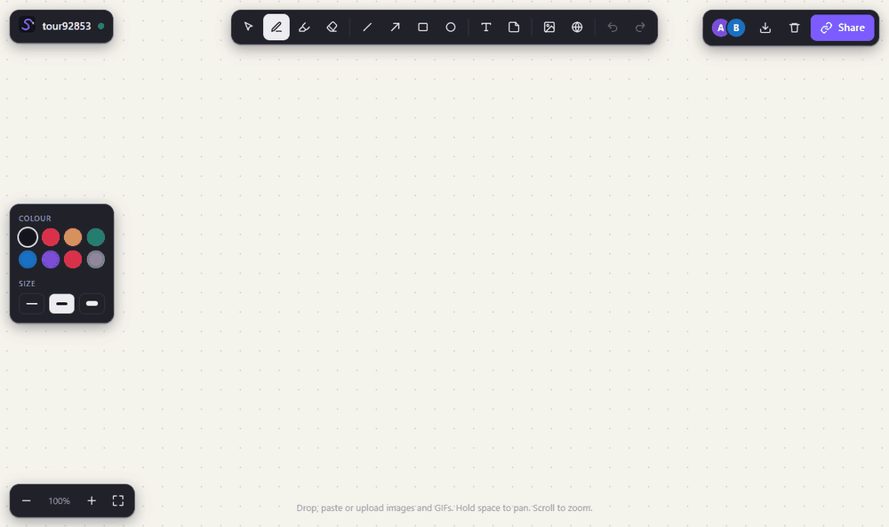
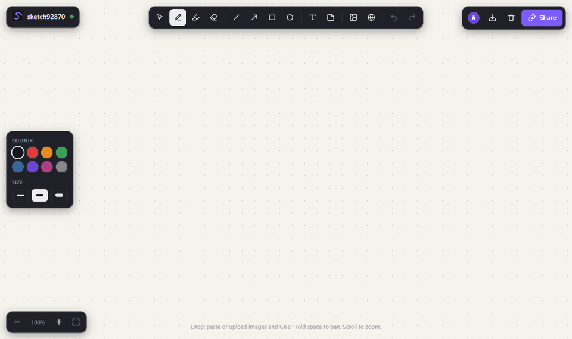
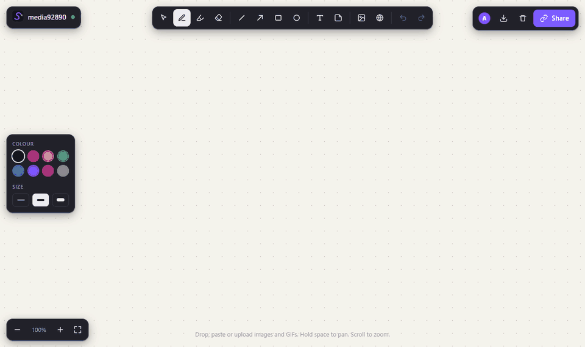

<p align="center"></p>

<h1 align="center">Scrawl</h1>

<p align="center"><b>A real-time collaborative whiteboard, written in Rust.</b><br>
Draw · write · drop in images and GIFs · live cursors · no accounts</p>

<p align="center">
  <a href="https://scrawlboard.vercel.app"><b>scrawlboard.vercel.app</b></a>
</p>

<p align="center">
  <a href="../../releases/latest"></a>
  <a href="../../actions/workflows/ci.yml"></a>
  
  
  
</p>

<p align="center">
  <a href="#run-it">Run it</a> ·
  <a href="#features">Features</a> ·
  <a href="#deploy">Deploy</a> ·
  <a href="#how-it-works">How it works</a> ·
  <a href="docs/ARCHITECTURE.md">Architecture</a> ·
  <a href="docs/DEPLOY.md">Deploy guide</a>
</p>

<p align="center"></p>

---

## Run it

Scrawl is one binary: the server, the web app and the sync. No database.

```bash
cargo run --release
# open http://localhost:7878
```

Or grab a build from the **[Releases page](../../releases/latest)** (Windows, macOS, Linux, Raspberry Pi 64-bit), unpack it and run `scrawl`.

| Environment variable | Default | Meaning |
|---|---|---|
| `PORT` | `7878` | port to listen on (set by hosts like Render, Fly and Railway) |
| `SCRAWL_ADDR` | `0.0.0.0:7878` | full listen address, overrides `PORT` |
| `SCRAWL_DATA` | `data` | folder for uploads (`files/`) and, with `SCRAWL_KEEP`, boards (`boards/`) |
| `SCRAWL_KEEP` | unset | keep boards on disk after everyone leaves (default: delete empty boards and their pictures) |
| `SCRAWL_GRACE_SECS` | `60` | how long an empty board waits before it is deleted |
| `SCRAWL_TRUST_PROXY` | unset | set behind a reverse proxy so rate limits use `X-Forwarded-For` |

```bash
docker build -t scrawl . && docker run -p 7878:7878 -v scrawl-data:/data scrawl
```

## Features

- **Draw and write**: pen, highlighter, eraser, lines, arrows, rectangles, ellipses, text and sticky notes on an endless pan/zoom canvas. Eight colours, three sizes.
- **Images and GIFs**: upload, drag and drop, paste from the clipboard, or add by link. GIFs keep animating on the board.
- **Live together**: edits, cursors and who is online show up instantly over WebSockets.
- **Edit anything**: select, move, resize, recolour, delete. Undo and redo your own actions.
- **Temporary**: a board exists only while someone is on it. When the last person leaves it is deleted (a self-hosted server waits a minute, so a refresh is safe, and also removes the pictures uploaded to it). Use Export to keep a picture.
- **Export** a board as PNG. **Share** copies the board link.
- **Keyboard**: `V` select, `P` pen, `H` highlighter, `E` eraser, `L` line, `A` arrow, `R` rectangle, `O` ellipse, `T` text, `N` note, `Space` pan, `Ctrl+Z` undo.
- **Small**: about 3 MB binary with the whole web app embedded.

| Sketching | Images and GIFs |
| --- | --- |
|  |  |

## Two ways to run it

**On the web (no server):** [scrawlboard.vercel.app](https://scrawlboard.vercel.app) is a static site. Open `scrawlboard.vercel.app/ANYCODE` and you are on that board; send the link and others join. Browsers connect to each other directly over WebRTC: the first person to open a code hosts it, and if they leave, someone still on the board takes over with their copy. When the last person leaves, the board is gone. A free public [PeerJS](https://peerjs.com) server only introduces browsers to each other. Pictures are limited to about 3 MB (GIFs about 2.2 MB) because they travel inside the board.

**Self-hosted (Rust server):** 10 MB uploads, works through strict firewalls, and boards are deleted when empty unless you set `SCRAWL_KEEP=1`. See [Run it](#run-it) and **[docs/DEPLOY.md](docs/DEPLOY.md)**. Set `mode: "server"` in [`site/config.js`](site/config.js) to point the static site at your own server.

[](https://render.com/deploy?repo=https://github.com/TopLuau/scrawl)

## How it works

- `src/main.rs` is the whole server ([axum](https://github.com/tokio-rs/axum)): serves the web app, relays edits per board room over WebSockets, saves rooms every two seconds, accepts image uploads.
- `web/` is the front end: plain JavaScript drawing to SVG, embedded into the binary at compile time.
- `web/p2p.js` is the browser-to-browser transport: the host's browser does what the Rust server does (validate, keep state, relay).
- `site/` is the static site (landing page and boards), generated from `web/` by `tools/build-site.py`.
- The board code in the URL (`/<code>`) is the only access control: anyone with the link can edit. Treat links like unlisted documents.

More in [docs/ARCHITECTURE.md](docs/ARCHITECTURE.md).

## Limits and abuse protection

Per board: 6000 objects, 60 people. Per message: 512 KB, plus a per-connection rate limit. Uploads: 10 MB, PNG/JPEG/GIF/WebP only (checked by file signature), 30 per minute per IP, served with `nosniff` and a locked-down CSP. Every object field is validated on the server (types, colours, numbers; image URLs must be `http(s)` or an uploaded file).

## Tested and not tested

Tested on Windows 11 in Chrome (built-in browser pane and Playwright): peer-to-peer boards across three separate browser sessions through the public PeerJS server (join by code, live sync, a 2.3 MB picture, cursors, the host leaving and another person taking over with everything intact), joining, pen strokes, text editing, moving and resizing objects, delete/undo/redo, GIF drop, upload and animation, live sync and presence between two real browser sessions, an empty board and its uploaded picture being deleted after the last person leaves (server) and a new visitor finding an empty board (peer-to-peer), rejection of bad objects and non-image uploads. Unit tests cover the server's input validation (`cargo test`).

Not tested: peer-to-peer across different networks and NATs (all test browsers were on one machine), Safari and Firefox, real touch devices (pinch zoom is implemented but untried), several people on separate machines, PNG export of boards with remote images (cross-origin images are skipped if the host blocks fetching), the Render and Fly configs, and the Linux/macOS builds (CI builds them).

Known gaps: peer-to-peer boards need a direct connection, which some strict networks block (no relay is built in); no multi-select, undo is local to each person, no authentication or board passwords.

## Development

```bash
cargo test                      # server validation tests
cargo clippy --all-targets
python tools/make-icon.py       # icon, favicon, social card (needs Pillow)
python tools/build-site.py      # regenerate site/ after editing web/
python tools/make-demo-assets.py && python tools/capture.py http://127.0.0.1:7879   # re-record the GIFs (needs Playwright + Chrome)
```

## License

MIT. Icons in the landing page are from [Lucide](https://lucide.dev) (ISC).
